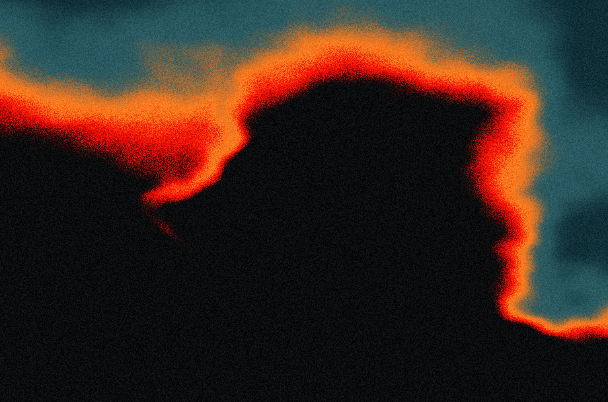

# Ember

A native macOS animated wallpaper: slow, grainy flame-like gradients rendered with Metal. The soft shapes, the charcoal/red/orange/teal palette, and the stable grain are all procedural; no image is loaded at runtime.

Ember started as a fork of [JerryI/SimplexFlame-OSX](https://github.com/JerryI/SimplexFlame-OSX). The look and the shader are unchanged; this fork renames the app, shares GPU resources between displays, and stops rendering when the desktop is hidden.



## Build and run

Requires macOS 13+ and Apple's Command Line Tools (`xcode-select --install`). No third-party dependencies or full Xcode installation required.

```sh
bash scripts/build.sh
open dist/Ember.app
```

## Turning it on and off

- **On:** open the app and click **Use as Wallpaper**, or pick **Enable Wallpaper** from the flame icon in the menu bar.
- **Off:** pick **Disable Wallpaper** from the flame menu. Your normal wallpaper is underneath and reappears at once.
- **Quit:** **Quit Ember** from the flame menu also reveals the normal wallpaper.

Ember remembers whether the wallpaper was on. If you quit with it on, the next launch goes straight to wallpaper mode with no preview window; use the flame menu to reach the controls.

## Controls

The preview window has flow speed, grain, and brightness sliders; settings are remembered. Day and night palettes follow the macOS appearance setting automatically. Click **Use as Wallpaper** to place the animation behind desktop icons on each connected screen. Use the flame menu-bar icon to reopen controls, pause, disable the wallpaper, or quit. It does not install a login item or change the system wallpaper image.

Check **Pomodoro · 20 Minutes** in the flame menu to enable repeating breaks. After 20 minutes of normal work, a fullscreen splash over the animated wallpaper on every display counts down from 30 seconds to zero, then returns to the previous mode and starts the next 20-minute interval. Double-click anywhere or press Escape to skip a break. Uncheck the menu item to stop the cycle. Sleep counts toward the interval; a break that becomes due during sleep appears on wake.

## Energy

Ember picks its own frame rate; there is nothing to set.

| Situation | What Ember does |
|---|---|
| Plugged in, most of the desktop showing | 30 fps |
| On battery, or windows and widgets hide more than half of the desktop | 15 fps |
| Only slivers of desktop showing (under 5%), or Low Power Mode is on | no frames drawn |
| Desktop fully covered, full-screen app in front, Space not showing, display asleep | no frames drawn |

A frame costs about the same however little of the desktop is visible, so drawing fewer frames is where the saving is. The flame's clock only advances when a frame is drawn, so changing tier never makes it jump; a paused flame simply continues from where it stopped. Coverage is estimated once a second from the window server's list of on-screen windows (window bounds, so rounded corners and shadows are ignored, and translucent desktop widgets count as cover). On an M5 Max the whole thing is under 1% of the GPU and about 1.5% of one CPU core at 30 fps (a little more on battery, where the cores clock lower), roughly a third less at 15 fps, and nothing when paused.

`defaults write local.ember.wallpaper adaptiveFrameRate -bool false` keeps 30 fps whenever any part of the desktop shows, whatever the power source.

## Render a still

```sh
mkdir -p output
dist/Ember.app/Contents/MacOS/Ember --snapshot output/frame-0.png 0
dist/Ember.app/Contents/MacOS/Ember --snapshot output/frame-30.png 30
# Preview the light palette (snapshots default to dark):
dist/Ember.app/Contents/MacOS/Ember --snapshot output/daylight.png 0 --light
# Match a specific display's pixel dimensions:
dist/Ember.app/Contents/MacOS/Ember --snapshot output/display.png 30 --width 2560 --height 1600
```

The optional last argument is animation time in seconds. This uses the same Metal shader as the live app.

## Measure GPU cost

```sh
dist/Ember.app/Contents/MacOS/Ember --benchmark              # two-pass renderer (what the app uses)
dist/Ember.app/Contents/MacOS/Ember --benchmark --reference  # single full-resolution pass, for comparison
```

On an M5 Max the two-pass renderer takes about 0.23 ms of GPU time per frame at 3472×2266, versus 1.6 ms for the reference pass.

## Implementation

- Swift/AppKit app with an `MTKView` and fullscreen triangles.
- Four-octave gradient noise, slow domain warping, shaped warm folds, and a nonlinear color ramp in `Flame.metal`.
- Screen-anchored grain: it does not randomly flicker every frame.
- 30 fps with output matching each screen's full backing resolution, including Retina scaling.
- Two render passes: calculate the smooth scalar flame field at one quarter of the output width/height, then interpolate it and apply the palette and grain at full output resolution. Only the internal smooth field is approximated; the finished image is not upscaled. A padded border preserves interpolation at screen edges.
- One Metal device, command queue, and compiled shader per process (`MetalContext`), shared by the preview and every display. Toggling the wallpaper, changing displays, or starting a break never recompiles the shader.
- Each desktop window pauses rendering while it is fully covered by other windows, while its Space is not showing, or while a full-screen app is in front, and resumes where it left off when any part of it shows again. See Energy above for the frame-rate tiers. Rendering also pauses on display/system sleep and manual pause; hidden/occluded previews stop rendering.
- One click-through desktop-level window per display *per Space*. A window shared by all Spaces is composited beneath the Space-switch animation, so the system wallpaper showed for about half a second whenever a full-screen app opened or closed. A window that belongs to its Space slides with the desktop instead. Windows are made lazily: the first time a desktop Space shows on a screen it gets one (that one first visit still shows the system wallpaper during the slide); full-screen Spaces never get one, which Ember tells apart by the absence of the desktop-picture and desktop-icon windows from the on-screen window list. Windows rebuild when displays change. `defaults write local.ember.wallpaper desktopsOnAllSpaces -bool true` restores the single shared window.
- Pomodoro reuses the wallpaper views and adds an AppKit text overlay updated once per second during breaks. Work intervals use a single scheduled timer. When disabled there is no running timer or overlay.
